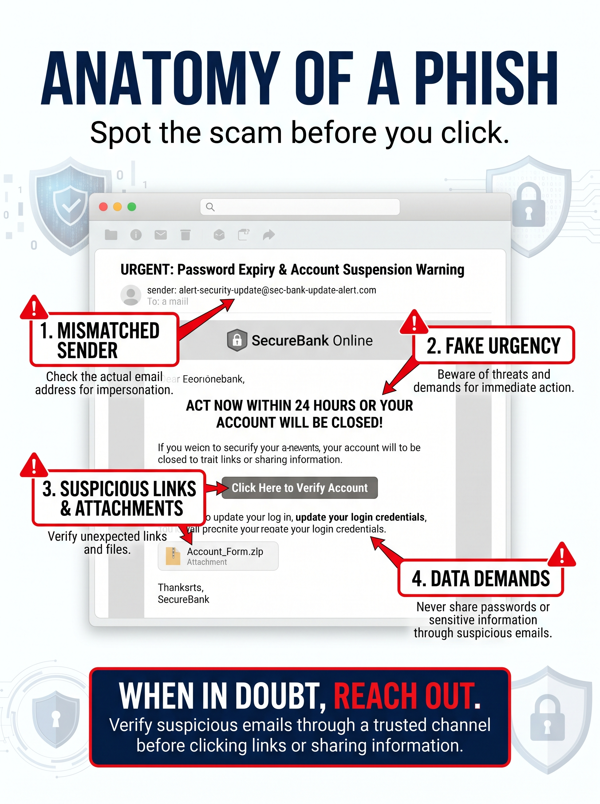
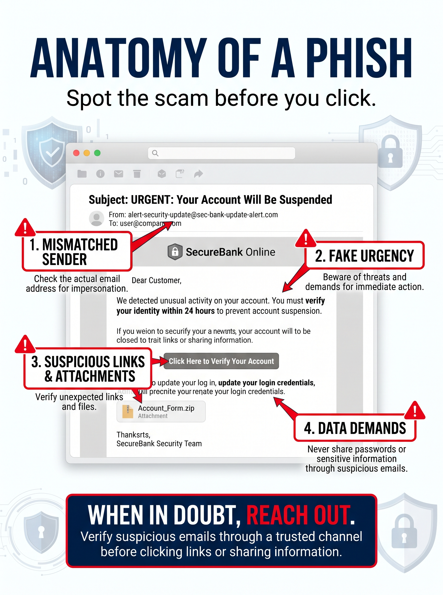
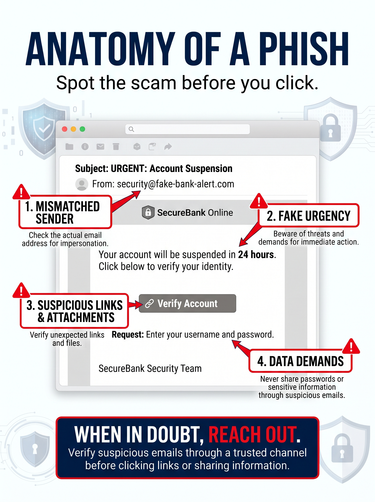

# Project 02: AI Image Generation — Results & Evaluation

## Project Summary

Using Google Gemini, I created and refined a cybersecurity
awareness poster titled "Anatomy of a Phish."

The objective was to produce an educational visual that
helps employees identify common phishing email threats.

Three versions were generated and evaluated.

---

## Version 1: Original Image

### Observations

The initial poster successfully established the visual
concept and included four phishing warning signs.

Strengths:
- Professional color palette and layout.
- Clear cybersecurity theme.
- Effective use of warning labels and arrows.
- Strong headline and call to action.

Issues Identified:
- Several spelling and text-generation errors.
- Unreadable sentences within the example email.
- Overlapping text and visual elements.
- Some warning annotations were difficult to follow.

### Evaluation

The design was visually appealing but required
significant corrections before professional use.

---

## Version 2: First Revision

### Observations

The second version improved the organization of
the example email and reduced some visual clutter.

Improvements:
- Clearer email subject line.
- Better organization of warning labels.
- More readable instructional text.
- Improved spacing in parts of the design.

Remaining Issues:
- Some email text remained distorted.
- Certain annotations still overlapped.
- The example email contained unnecessary details.

### Evaluation

The revised image showed improvement but still
required additional refinement.

---

## Version 3: Final Image

### Observations

The final version simplified the phishing email
and improved the overall readability.

Improvements:
- Shorter, clearer email content.
- More consistent warning labels.
- Improved visual hierarchy.
- Reduced text distortion.
- Clearer identification of phishing tactics.

### Evaluation

The final version was the strongest of the three.

However, the poster still requires a final review
of text accuracy, layout, and cybersecurity guidance
before being distributed professionally.

---

## Comparative Evaluation

| Criteria | Original | Revision 1 | Final |
|---|---|---|---|
| Visual design | Good | Good | Good |
| Text readability | Poor | Fair | Improved |
| Warning labels | Present | Clearer | Clear |
| Email example | Confusing | Partially improved | Simplified |
| Professional readiness | Needs revision | Needs revision | Needs final review |

---

## Key Findings

### 1. AI Image Generation Has Limitations

Gemini successfully generated a professional-looking
cybersecurity poster but struggled with accurate
text rendering.

### 2. Iterative Prompting Improved Results

Providing feedback about spelling, readability,
and layout helped improve subsequent versions.

### 3. Simpler Prompts Produced Better Results

Reducing unnecessary text and simplifying the
example email improved the final image.

### 4. Human Review Remains Essential

AI-generated educational materials must be checked
for accuracy before professional distribution.

This is especially important for cybersecurity
content, where incorrect information could
mislead employees.

---

## Skills Demonstrated

- Generative AI image creation
- Multimodal prompt engineering
- Iterative prompt refinement
- AI output evaluation
- Quality assurance
- Cybersecurity awareness
- Technical documentation

---

## Conclusion

This project demonstrated how generative AI can
support workplace cybersecurity education.

Through three iterations, I identified weaknesses,
refined my prompts, and improved the final output.

The experience reinforced the importance of
human oversight, accuracy verification, and
continuous improvement when using AI tools.

## Project Status

Completed — Google AI Professional Certificate Lab.
